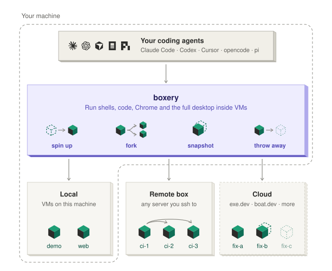
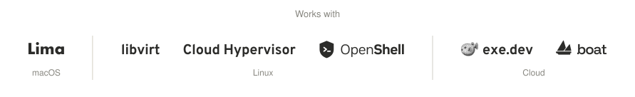
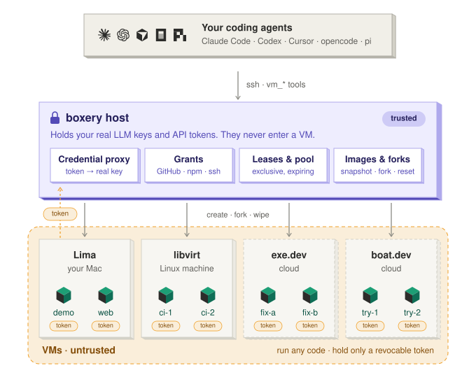
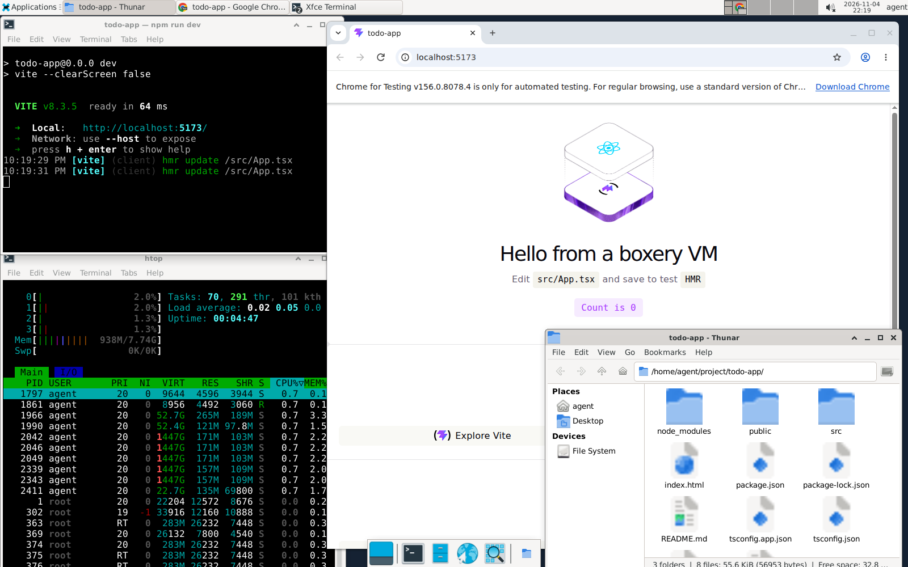

<p align="center">
  <picture>
    <source media="(prefers-color-scheme: dark)" srcset="docs/brand/lockup-dark.svg">
    
  </picture>
</p>

<p align="center">
  Easiest way to give your coding agents VMs
</p>

<p align="center">
  <a href="https://github.com/modem-dev/boxery/actions/workflows/ci.yml"></a>
  
  <a href="https://www.npmjs.com/package/boxery-vm"></a>
  <a href="docs/install.md#choosing-a-backend"></a>
  <a href="docs/mcp.md"></a>
</p>

<p align="center">
  <a href="docs/install.md"><b>Install</b></a> ·
  <a href="docs/mcp.md">MCP server</a> ·
  <a href="docs/pi-extension.md">pi extension</a> ·
  <a href="docs/cli.md">CLI</a> ·
  <a href="host/backends/README.md">Backends</a> ·
  <a href="docs/README.md">All docs</a>
</p>

<p align="center">
  <picture>
    <source media="(prefers-color-scheme: dark)" srcset="docs/diagrams/hero-dark.svg">
    
  </picture>
  <br>
  <a href="docs/install.md#choosing-a-backend">
    <picture>
      <source media="(prefers-color-scheme: dark)" srcset="docs/diagrams/works-with-dark.svg">
      
    </picture>
  </a>
</p>

---

> [!WARNING]
> **Early-stage, experimental software.** Expect rough edges and breaking changes between releases.

boxery lets your agents manage their own Linux VMs: on your Mac, a Linux server, a sandbox provider like exe.dev or boat.dev, or all of them at once. Your agent stays on your machine with your login and setup; the VM is where it works, and your keys never go in.

## Quick start

Give this prompt to your agent:

```text
Read github.com/modem-dev/boxery and set up boxery on this machine.
Then spin up a VM with `boxery new demo` and open its desktop.
```

Prefer to do it by hand? See [Install](#install).

## What it's for

- **Dev boxes.** A full Linux machine per project or branch. `ssh demo.boxery`, or open it in VS Code.
- **Safe sandboxes.** Let an agent install anything and run code you don't trust, away from your laptop and your keys.
- **Parallel attempts.** Fork a running VM, try three fixes at once, keep the one that works.
- **Browser and desktop tasks.** Chrome, clicks and screenshots on a real desktop you can watch live.
- **Always-on agents and long jobs.** Run them on a server or in the cloud, and they keep going after you close your laptop.

## Why boxery

- **Built for agents.** Agents create, fork and drive VMs themselves over [MCP](docs/mcp.md): Claude Code, Codex, Cursor, opencode or any MCP client, plus a native [pi](docs/pi-extension.md) extension.
- **Fast.** A full desktop VM in about 13 s on libvirt, or a [headless](docs/cli.md#lifecycle) one with no desktop at all. Snapshot a running VM in about 1 s.
- **Mix VM providers.** One MCP server drives your Mac, a Linux server and sandbox providers (exe.dev, boat.dev) [at once](docs/hosts.md), with the same tools on each.
- **Your credentials never enter a VM.** VMs get a revocable token, and the host swaps in your real key. A VM gets nothing by default, not even an LLM, until you [grant it](docs/grants.md).

## How it works

- **On your machine**, the boxery MCP server (or pi extension) gives your agent the `vm_*` tools.
- **The boxery host** is a machine you run: your Mac, a Linux box, or a small VPS for cloud VMs. The tools reach it over ssh. It holds your keys and grants, and creates, forks and wipes VMs.
- **The VMs** are untrusted. They run anything, and hold only a revocable token that the host swaps for your real key.

Your machine and the host can be the same one. [Security model →](docs/security.md)

<p align="center">
  <picture>
    <source media="(prefers-color-scheme: dark)" srcset="docs/diagrams/host-dark.svg">
    
  </picture>
</p>

## Platforms

The host runs VMs on your Mac, on Linux, or in the cloud. Each backend is a stack of existing tools, and boxery drives the top of it, so agents get the same tools on every one except OpenShell. One MCP server can drive several hosts [at once](docs/hosts.md). [Choosing a backend →](docs/install.md#choosing-a-backend)

<p align="center">
  <picture>
    <source media="(prefers-color-scheme: dark)" srcset="docs/diagrams/layers-dark.svg">
    
  </picture>
</p>

- **macOS: Lima.** VMs on the Mac you're on, through Apple's Virtualization framework. The quickest way to try boxery, and everything stays local.
- **Linux: libvirt.** QEMU on KVM, and the fastest backend. Use a physical machine: a desktop, a laptop or a home server. A VPS works only if it offers nested virtualization.
- **Cloud: exe.dev.** VMs on exe.dev, with no hardware of your own. The host keeps a tunnel to each VM, so put it on an always-on machine such as a small VPS, and use your laptop as a controller.

### Experimental

- **Linux: Cloud Hypervisor.** A leaner VMM on the same KVM, with no libvirt: boxery manages it itself, with a systemd unit per VM.
- **Linux: [OpenShell](docs/openshell.md).** Headless sandboxes from [NVIDIA's OpenShell](https://github.com/NVIDIA/OpenShell), behind its gateway, with a policy on what each one can read and reach. With its Docker driver they're containers on the host's kernel, not VMs. No desktop, snapshots, forks or pool.
- **Cloud: boat.dev.** VMs on boat.dev, with no hardware of your own. For long-running work, keep the host on an always-on machine such as a small VPS.

## Install

The easiest way is to give this prompt to your agent:

```text
Read github.com/modem-dev/boxery and set up boxery on this machine.
Then spin up a VM with `boxery new demo` and open its desktop.
```

Or by hand, on a Mac:

```bash
brew install lima jq node   # jq: the Lima backend reads limactl's JSON with it
npm install -g boxery-vm
boxery-host init --backend lima && boxery-host build-base
boxery setup local
```

`build-base` builds the desktop image once (about 3 min); skip it if you only want headless VMs. On Linux or in the cloud, see the [install guide](docs/install.md#choosing-a-backend).

Then connect your agent:

```bash
npx add-mcp boxery-vm      # Claude Code, Codex, Cursor, VS Code, opencode, Zed, …
pi install npm:boxery-vm   # or the native pi extension
```

And ask: *"Clone my repo in a VM, start the dev server, and screenshot the homepage in Chrome."*

## What your agent gets

| Tools | |
|---|---|
| `vm_bash` `vm_read` `vm_write` `vm_edit` `vm_jobs` `vm_copy` | Shell, files and background jobs |
| `vm_screenshot` `vm_click` `vm_type` `vm_key` `vm_scroll` `vm_browser` | Computer use and Playwright on the desktop |
| `vm_manage` `vm_info` | Create, fork, snapshot, revert and remove VMs |
| `vm_grant` `vm_lease` | Ask you to grant access (GitHub, ssh-agent, env vars), or lease a VM from a shared pool |

You can also drive VMs yourself with the [CLI](docs/cli.md): `boxery attach demo`, `boxery desktop demo`.

<p align="center">
  
  <br>
  <sub>Every VM is a full Linux desktop your agent can drive: terminals, a file manager, and a real Chrome showing the dev server it just started.</sub>
</p>

## Documentation

| | |
|---|---|
| [Install](docs/install.md) | Hosts on every backend, laptop setup, LLM providers |
| [MCP server](docs/mcp.md) | stdio on your laptop, or Streamable HTTP over Tailscale |
| [pi extension](docs/pi-extension.md) | `--vm`, `/vm` commands, tools, fan-out |
| [CLI reference](docs/cli.md) | Every `boxery` and `boxery-host` command, and their `--json` output |
| [Backends](host/backends/README.md) | libvirt, Lima, Cloud Hypervisor, exe.dev, boat.dev, OpenShell, and the backend contract |
| [Grants](docs/grants.md) | Give a VM LLM providers, GitHub/HTTPS APIs (secret stays on the host), your ssh-agent, env vars, or files |
| [Named hosts](docs/hosts.md) | Multiple hosts, one controller and MCP server |
| [Shared pool & leases](docs/pool.md) | Several agents, one pool of VMs, no collisions |
| [GitHub Actions runners](docs/github-runners.md) | Ephemeral self-hosted runners: every job in a freshly reset pool VM |
| [Security model](docs/security.md) | Credential proxy, isolation, what a VM can and can't reach |
| [Architecture](ARCHITECTURE.md) | Design, roadmap, and failure modes |

## Status

libvirt, Lima and exe.dev are stable. The boat.dev, Cloud Hypervisor and OpenShell backends are experimental. See the [roadmap](ARCHITECTURE.md#roadmap).

## Contributing

Bug reports and PRs are welcome. See [CONTRIBUTING.md](CONTRIBUTING.md).

```bash
npm run lint && npm test && npm run test:shell
```

## Sponsor

Sponsored by [Modem](https://modem.dev?utm_source=github&utm_medium=oss&utm_campaign=oss_boxery&utm_content=readme_footer).

<a href="https://modem.dev?utm_source=github&utm_medium=oss&utm_campaign=oss_boxery&utm_content=readme_footer">
  <picture>
    <source media="(prefers-color-scheme: dark)" srcset="https://modem.dev/images/logo/svg/modem-combined-white.svg">
    <source media="(prefers-color-scheme: light)" srcset="https://modem.dev/images/logo/svg/modem-combined-black.svg">
    
  </picture>
</a>

## License

[MIT](LICENSE) © Ben Vinegar
