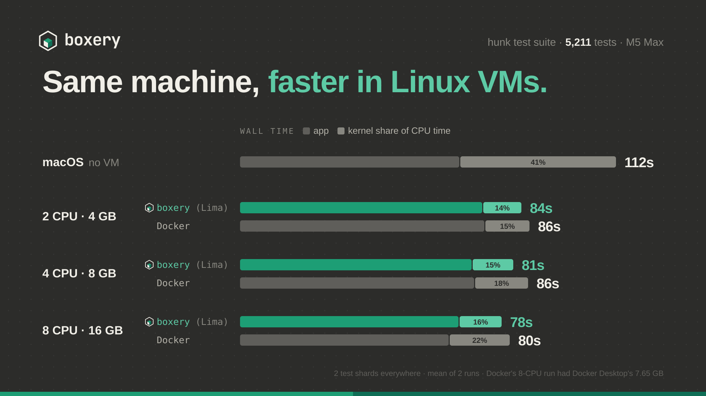

# hunk's test suite: macOS vs boxery VMs vs Docker

← [Back to research](../README.md)

**Question.** On one Mac, is a large TypeScript test suite faster on macOS itself, in a boxery (Lima) Linux VM, or in Docker? And how much does the VM's size matter?

**Answer.** Every Linux VM beat macOS: 78–86 s against 112 s. Size barely mattered: 2 CPUs finished within 6 s of 8. At matched sizes boxery's Lima VMs were 2–4 s faster than Docker.

| | |
|---|---|
| Subject | [modem-dev/hunk](https://github.com/modem-dev/hunk) at [`503efd5a`](https://github.com/modem-dev/hunk/commit/503efd5aa664e78241139ee9f02ae7942e811d95), `bun run test`, 5,211 tests |
| Machine | Apple M5 Max (`Mac17,7`), 18 cores (6 + 12), 128 GB, macOS 26.6.1, on mains power |
| When | 3 November 2026 |
| Data | [`results.json`](results.json): every run, including the ones we threw out |

## Results

Mean of two runs each, with the suite split into 2 shards everywhere. "Kernel share" is the share of CPU time spent in the OS kernel (sys ÷ (user + sys)).

| Environment | CPUs | Memory | Wall | Kernel CPU | Kernel share | vs macOS |
|---|---|---|---|---|---|---|
| macOS, no VM | 18 | 128 GB | **112.1 s** | 42.9 s | 41% | 1.00× |
| boxery (Lima) small | 2 | 4 GB | **83.9 s** | 9.2 s | 14% | 1.34× |
| Docker | 2 | 4 GB | 86.3 s | 10.8 s | 15% | 1.30× |
| boxery (Lima) standard | 4 | 8 GB | **81.5 s** | 10.9 s | 15% | 1.38× |
| Docker | 4 | 7.65 GB* | 85.9 s | 15.7 s | 18% | 1.31× |
| boxery (Lima) large | 8 | 16 GB | **78.0 s** | 11.4 s | 16% | 1.44× |
| Docker | 8 | 7.65 GB* | 80.4 s | 18.1 s | 22% | 1.39× |
| Docker, no limits | 18 | 7.65 GB | 80.4 s | 30.0 s | 32% | 1.39× |
| Docker, repo mounted from macOS | 18 | 7.65 GB | 91.5 s | 37.4 s | 36% | 1.23× |

\* Docker Desktop's VM had 7.65 GB, so containers couldn't be given 8 or 16.

At 1 shard, which is hunk's default on macOS, macOS took 154 s and the large Lima VM 138–148 s.

## What we learned

1. **Linux wins on the same hardware.** The tests' own CPU time was about the same everywhere: 58–71 s of user time. The gap is all in the kernel. macOS spent 43 s there and boxery's VMs 9–12 s. The suite starts thousands of short processes (git, bun, node). Starting a process is several times cheaper on Linux than on macOS, even inside a VM. On macOS, `/usr/bin/git` is also an `xcrun` shim, which adds about 6 ms to every call.
2. **A small VM is enough.** Going from 2 to 8 vCPUs saved about 6 s in both Lima and Docker. Most of this suite waits on work that runs one step at a time, not on CPU.
3. **boxery's Lima VMs edged out Docker at every size.** At 2 CPUs Docker's container layer costs almost nothing: 11 s of kernel time against Lima's 9 s. But Docker's kernel time grew with the CPUs it was given (11, 16, 18 and 30 s), while Lima's stayed flat. Every container shares one 18-CPU VM, even when it's limited to fewer. Our guess is that the extra kernel time comes from that, but we didn't measure it.
4. **Keep the repo inside the guest.** Mounting the checkout from macOS into Docker cost 11 s (91.5 s against 80.4 s), though that still beat macOS.

## Caveats

- One machine, and two runs per configuration. The 1-shard Lima runs varied by 10 s, and the slower one was the first run in a new VM.
- macOS skips 12 more tests than Linux (55 against 43), all session end-to-end tests that only run on Linux. So macOS did slightly *less* work.
- macOS and Docker ran [the patch](hunk-test-isolation.patch); Lima ran the clean commit. The patch only touches tests: it gives them empty config dirs and resolves macOS's `/var` → `/private/var` link. Before it, macOS loaded an extension from the developer's own config, and 52 tests failed.
- Every Docker run failed the same 2 tests, which fail in milliseconds. A file-watcher test is flaky on macOS.
- The final macOS baseline was measured about 15 hours after the Lima runs. The earlier macOS runs (109 and 111 s) agree with it but had the leaked-extension failures, so they're marked invalid.
- Docker Desktop and three other idle boxery VMs were running throughout, the same for every run.

## Run it again

Follow [the methodology](../METHODOLOGY.md) with these specifics:

- **Checkout:** clone [modem-dev/hunk](https://github.com/modem-dev/hunk), `git checkout 503efd5aa664e78241139ee9f02ae7942e811d95`, then `git apply path/to/hunk-test-isolation.patch`. Pack it with `pack-repo.sh`.
- **Toolchain:** Bun 1.4.3, Node 24, Git 2.56 from the [git-core PPA](https://launchpad.net/~git-core/+archive/ubuntu/ppa) on Ubuntu 24.04. On macOS, use the system Git.
- **Command:** `HUNK_TEST_SHARDS=2 bun run test`, counted with `time-runs.sh --counts bun`.
- **boxery VM:** Ubuntu 24.04 on Lima's `vz` backend, resized to each shape with `boxery resize`, and the repo copied onto the VM's disk.
- **Docker:** the [Dockerfile](Dockerfile) here, run with `--cpuset-cpus 0-1 --memory 4g`, `0-3 --memory 8g` and `0-7`.
- **Card:** `node make-card.mjs` redraws [`card.svg`](card.svg) from `results.json`.
